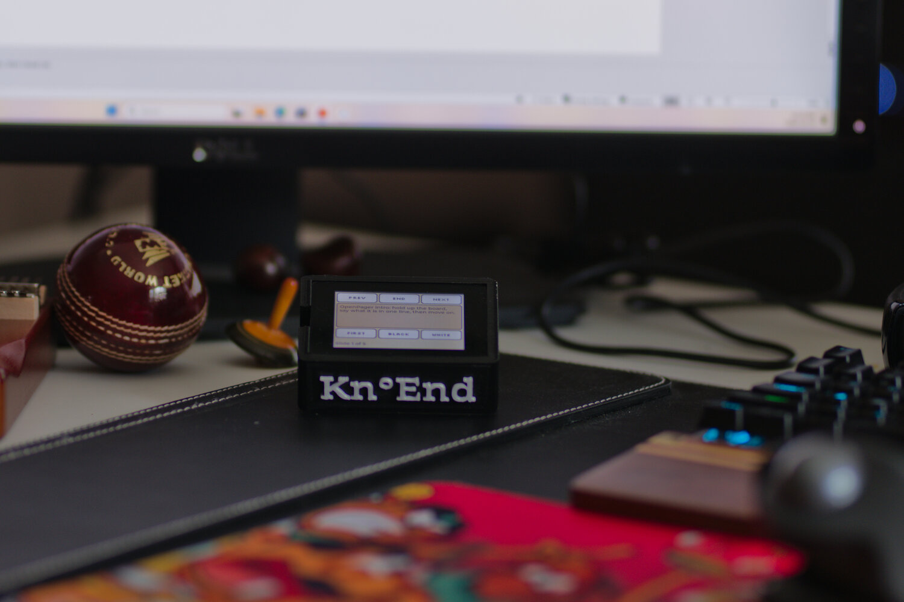

# Kn°End

An open-source, cross-OS shortcut keypad and pager built on inexpensive ESP32-S3 touch boards.

*Kn°End* is said "no end" (silent K, as in *know*); written `knoend` for the command and in network
names, and KnoEnd in plain text.

Said aloud, it is close to the Tamil **நோண்டு** (*nōṇḍu*). The word literally means "dig" or "poke
at", and colloquially it means tinkering: poking at a thing to see how it works and make it do
something new. That is the project: a cheap board, poked at until it does more, with no end to
what it can be set up for.

Kn°End turns an ESP32-S3 touchscreen board, from a 2.8" LCD to a 2.06" AMOLED watch, into keys that
change with the app, website or terminal program you are using. Each board connects to your
computer by USB, Bluetooth or home Wi-Fi, and several boards can follow one computer at once. Over
Wi-Fi or Bluetooth it becomes a pager: carry it around the house, see status from your computer, and
answer a prompt (approve a coding agent's command, answer its questions) from another room. With a
microphone it listens: sing or play a note and it reaches a music app as MIDI.

> **Status: early development, released as v0.3.0.** Setting up, the keys, the Wi-Fi and
> Bluetooth links, AI-drafted layouts and flashing work on Linux (X11), macOS and Windows. See
> [What works today](#what-works-today). **To set one up, follow [docs/setup.md](docs/setup.md).**
>
> **Project page:** <https://jalabulajunx.github.io/knoend/> · **Demo video:** <https://youtu.be/d6Set7CRCjE> ·
> Built for [Build North: Ship Something Real](https://build-north.devpost.com/), see
> [Build North submission](#build-north-submission).

<p align="center">
  
  <br><sub>Presenting: the slide's speaker notes on the board. Enclosure designed and 3D-printed by Skanda.</sub>
</p>

## Videos

<table>
  <tr>
    <td colspan="3" align="center"><a href="https://youtu.be/d6Set7CRCjE"></a><br><b>Kn°End demo: keys that follow you</b></td>
  </tr>
  <tr>
    <td align="center" width="33%"><a href="https://youtu.be/ENpDMOkb7OI"></a><br>Linux and MuseScore</td>
    <td align="center" width="33%"><a href="https://youtu.be/iCj722lLwPk"></a><br>Terminal coding agents</td>
    <td align="center" width="33%"><a href="https://youtu.be/y1Sh5DLingc"></a><br>Contextual keys</td>
  </tr>
</table>

## Why

- **Shortcut keypads are closed and skip Linux.** Commercial keypads such as the Logitech MX Keypad
  run only through vendor software on Windows and macOS.
- **Every app needs setup.** A keypad is only useful where someone has already built a profile; an app
  or website nobody prepared gets blank keys. Here an AI drafts them, and you review.
- **Extensions are code.** Marketplace plugins run with your permissions. A shared layout should be
  safe to accept from a stranger.
- **The hardware is already cheap and common.** A board you may already own becomes the keypad.

## How it works

```
                        ┌────────────────────────── Computer (any OS) ─────────────────────────┐
┌── Board(s) ────────┐  │                                                                       │
│ Touch keys         │──┼── Bluetooth LE keyboard (HID) ───────────► Sees a keyboard            │
│ Status bar         │  │                                             (no install needed)       │
│ Its own look       │◄─┼── Wi-Fi WebSocket, USB serial, or ───────► Companion service (Rust)   │
│ Mic (some boards)  │  │   Bluetooth LE data (beside the keyboard)    - focused app / site /    │
│ Buttons, OLED care │  │                                                terminal program       │
└────────────────────┘  │   several boards at once: the same keys,     - layout libraries       │
                        │   each in its own look                       - agent hooks, MIDI       │
                        │                                              - AI drafting + assistant │
                        │   web app at http://127.0.0.1:7342 ◄──────── set up, keys, looks      │
                        └───────────────────────────────────────────────────────────────────────┘
```

- **The board works alone.** Paired over Bluetooth it is an ordinary keyboard on any computer, with
  nothing installed.
- **The companion adds the smarts.** A small local Rust service, used through a web app, watches
  which app, website or terminal program is in focus, picks the matching layout and pushes it to
  every connected board, carries out actions, and feeds the status bar. It also identifies boards
  (including ones it does not know, from the firmware they carry) and flashes them.
- **Layouts are data, not code.** A layout library is a TOML file checked by one validator, whether it
  is built in, contributed by the community, drafted by AI for an app nobody has configured, or your
  own override.

```toml
[pack]
name = "Amazon"
version = "1.2.0"
source = "community"   # builtin | community | ai | user

[match]
web = ["amazon.ca", "amazon.com", "amazon.*"]

[[key]]
label = "Orders"
speak = "Your orders"
action = { kind = "open", url = "/gp/your-account/order-history" }
```

### Safety rules

- Keys trigger only allowed actions: shortcuts, key sequences, same-site pages, page elements, media
  control, or commands you have named on your computer — never raw command lines.
- Buy, submit, send and delete need a second tap.
- Board and computer pair once with a shared key, handed over by USB; every Wi-Fi message is
  authenticated. Bluetooth data needs the encrypted link of the computer the board is bonded with.
- AI-drafted layouts are marked "unreviewed". Only the app ID, domain and page structure are sent to a
  model (for a terminal program: its name and one-line manual description), and a local model or a
  CLI you are already signed in to can be used instead.
- Third-party plugins (code) will only ever be a separate, opt-in tier.

## Supported boards

All boards run one universal firmware image; a small JSON definition per board describes its display,
touch controller, pins and buttons, so adding a board is usually a definition, not new code.

| Board | Status | Display | Touch | Extras |
| --- | --- | --- | --- | --- |
| ONX2432G028 | **supported** (tested) | 2.8" 320×240 ST7789 | CST826 | microphone |
| Freenove FNK0104B | **supported** (tested) | 2.8" 320×240 ILI9341 | FT6336 | native USB |
| Waveshare ESP32-S3-Touch-AMOLED-2.06 | unverified (run on the board, in v0.2.1) | 2.06" 410×502 AMOLED, QSPI (SH8601/CO5300) | FT3168 (FT5x06) | rounded corners, burn-in care, BOOT and power buttons |
| Espressif ESP32-S3-BOX-3 | unverified | 2.4" 320×240 ILI9342C | GT911 | |
| Waveshare ESP32-S3-Touch-LCD-2 | unverified | 2" 240×320 ST7789T3 | CST816D | |

"Unverified" means written from the maker's documentation, or run on the board but not yet over a
release cycle. Any ESP32-S3 board with octal PSRAM, an ST7789 or ILI9341 SPI display or an
SH8601-family QSPI AMOLED, and CST816, CST826, FT6336, FT5x06 or GT911 touch can be added; see
[docs/boards/research.md](docs/boards/research.md). A board Kn°End does not know is said plainly when
you plug it in: back its flash up before trying anything on it.

## What works today

Tested on an ONX2432G028 with Arch Linux (X11), macOS 26.6 (Apple silicon) and Windows 11, on a
Freenove FNK0104B with Linux and macOS, and on the Waveshare AMOLED with Linux:

**Setting up**
- The web app identifies the board, installs the firmware, pairs over USB, and sets Wi-Fi from a
  scanned list; Wi-Fi and Bluetooth are optional steps. "Add another board" for a second one.
- A setup assistant (AI) in the web app that sees what the service sees, runs checks, explains
  failures and offers one-click fixes; it also watches in the background and speaks up on its own.
- Downloads per release: the service for Linux and macOS, a Windows installer, firmware for every
  board, and the browser extension for Chrome and Firefox.

**Keys that follow you**
- Layouts follow the focused app and website (Linux X11, macOS, Windows; websites through the
  Chrome / Edge / Firefox extension) and the program in a terminal tab (Claude Code, `less`/`man`,
  or any program the AI drafts keys for: `sudo pacman` gets Yes and No that answer with Enter).
- "Keys for your apps": the service lists the apps installed on your computer and the AI drafts keys
  for several at once. Configure on the board drafts one on the spot. AI providers: Gemini, OpenAI,
  Anthropic, OpenRouter, local Ollama, or Claude Code / Antigravity CLI / Codex CLI already signed in.
- Edit keys live in the web app; a home screen of pinned and most-used apps when nothing is in front.
- Claude Code permission requests and questions answered from the board.
- PowerPoint: standard editing keys in edit mode; in presentation mode, the board switches to speaker notes paginated cleanly in the detail panel, with slideshow controls (Prev, Next, First, End, Black, White).

**Boards and links**
- Several boards on one computer at once, mirroring each other; each keeps its own look: key size,
  theme (Dark, White, Sepia), way round, Google Fonts and start-up size.
- Remove boards easily in the web app: forget/unpair completely or reset look settings.
- Every board reached over Wi-Fi (authenticated, found by mDNS), USB, or Bluetooth alone (the data
  service beside the keyboard; tested on Linux). As a Bluetooth keyboard it types with nothing
  installed.
- OLED boards dim after a minute, go dark after ten and shift the picture slowly; a power button
  turns the screen off, BOOT turns the page.

**Music**
- Boards with a microphone listen: a Listen key, a note sung or played, and it reaches MuseScore (or
  any music app) as MIDI from the "KnoEnd" device.

Not yet run: Bluetooth data on macOS and Windows, fonts over Bluetooth, the BOX-3 and Touch-LCD-2
definitions. What is on main in detail: [docs/status.md](docs/status.md).

## Getting started

[docs/setup.md](docs/setup.md) covers both setting up a board and working on the code. In short:
from the [latest release](https://github.com/jalabulajunx/knoend/releases/latest), run the Windows
installer (`knoend-setup-<version>-x86_64.exe`), or unpack `knoend` for Linux or macOS, plug in the
board, and run

```bash
./knoend serve     # opens the web app at http://127.0.0.1:7342
```

On Windows, open KnoEnd from the Start menu. The release notes say how to load the browser extension
and what to do about the unsigned-download warnings.

Problems:
[docs/knowledge/setup.md](docs/knowledge/setup.md). What is on main: [docs/status.md](docs/status.md).

### Codex interruptions (branch preview)

The Codex integration in this branch adds native lifecycle hooks for **local desktop and CLI
sessions**. Start the companion, open **Dashboard > Codex interruptions > Prepare hooks**, then
review/trust the exact hooks in Codex. No firmware update or PowerShell script is needed for hooks.
Completion alerts and Dismiss were physically confirmed on Windows with an ONX2432G028; desktop
and CLI were tested separately. The permission bridge supports Allow once/Deny, with a synthetic
Deny round-trip confirmed. Real policy-driven approvals remain unverified; ordinary question
answers stay in Codex. This work is not yet in a published release.

Follow [the Codex setup steps](docs/setup.md#codex-interruptions-local-desktop-and-cli) and
[the detailed behaviour, recipes and troubleshooting](docs/codex-interruptions.md).

## Build North submission

Kn°End is our entry to [Build North: Ship Something Real](https://build-north.devpost.com/)
(October 2026).

- **The user:** someone who works across many apps on Linux, macOS or Windows, owns or can buy a
  $20–40 ESP32-S3 touch board, and wants shortcut keys without vendor software: first of all the two
  of us, who use it every day for VS Code, Claude Code, YouTube, PowerPoint and MuseScore.
- **What is better because it exists:** keys follow the app, website or terminal program in front
  of you on all three operating systems, including apps nobody has set up (an AI drafts the keys,
  you review them); coding agents can be answered from another room; layouts are data, safe to
  share.
- **Path to production:** tagged releases with a Windows installer, Linux and macOS builds,
  firmware for five boards and a browser extension; a web app and setup assistant so anyone can
  set a board up without a developer; MIT licensed, with community layouts as TOML files.
- **Live link:** the [project page](https://jalabulajunx.github.io/knoend/) and the
  [latest release](https://github.com/jalabulajunx/knoend/releases/latest) (runs on your own
  computer with a board).
- **Demo video:** <https://youtu.be/d6Set7CRCjE>. Shorter videos: [Linux and
  MuseScore](https://youtu.be/ENpDMOkb7OI), [terminal coding agents](https://youtu.be/iCj722lLwPk),
  [contextual keys](https://youtu.be/y1Sh5DLingc).
- **Tech stack:** firmware in C on ESP-IDF 5.4.4 with LVGL and Bluedroid (Bluetooth LE); companion service
  in Rust (tokio, axum, tokio-tungstenite, btleplug, serialport); web app in plain HTML, CSS and JavaScript; browser extension
  (Manifest V3); JSON Schema and TOML for the shared contracts.
- **Partner platforms:** Anthropic's Claude is one of the AI providers for drafting keys and for the
  setup assistant (by API key or a signed-in Claude Code), and Claude Code permission requests are
  answered from the board. We did not use Expo, Clerk, Eon or SurrealDB.
- **Team:** Sundararajan Mohan and Tom Grabowski. Enclosure designed by Skanda.

### Prior work and what was built during the week

- **Before:** in August 2026 Sundar built [sidebar](https://github.com/jalabulajunx/sidebar), a
  private voice intercom for a few kids on the same ONX2432G028 board; seeing it work is what led to
  trying a keypad on that board. On 13 October a bench prototype grew out of it (USB serial plus a
  Bluetooth keyboard on one ONX2432G028). No code from sidebar or the prototype is here: the
  prototype's board drivers were the vendor's example code, so the board support was rewritten from
  the schematics and Espressif's components. What carried over was experience with the board and
  ESP-IDF. Skanda designed the Kn°End enclosure from scratch.
- **During the week:** everything in this repository. The first log entry is 16 October 2026 and
  the first commit 17 October; [docs/log.md](docs/log.md) records each day's work, who did it,
  with which AI agent, and what was tested on which hardware.
- **Templates and third-party code:** Espressif's `esp_hid_device` example (Unlicense / CC0),
  Espressif's display and touch components, Waveshare's board support package for the AMOLED's
  pins and start-up commands, and the AXP2101 register map from XPowersLib; see
  [Pre-existing work and tools](#pre-existing-work-and-tools).
- **AI tools:** Claude Code (planning, research, most of the code), OpenAI Codex (code review of
  pull requests) and Google Antigravity (some features and a release). Each log entry names the
  agent used.

## Repository layout

```
spec/                 shared contracts: packet protocol, JSON schemas (incl. board definitions), examples
firmware/             ESP-IDF project (C): one universal image
  main/               grid UI, keys, protocol, Bluetooth keyboard + data / Wi-Fi / serial links, listening
  components/         board_generic (drivers from the board definition), board_api, esp_hid_gap
  boards/             catalog.json and definitions/*.json, one per board
companion/            Rust workspace; the `knoend` binary (service + CLI)
  crates/             core, transport (Wi-Fi, USB, Bluetooth), focus, input, flash, agents, media, desktop, cli
web/                  web app served by the service (setup wizard, assistant, dashboard)
recipes/              keys for apps, sites and coding agents (*.toml), compiled in; see recipes/README.md
docs/                 setup guide, knowledge base, board research, log, decisions/
installer/            Windows installer (Inno Setup) and release notes
extension/            browser extension (Chrome, Edge, Brave, Firefox)
tools/                spec validator, firmware release packager, extension builder, bench tools
site/                 project page on GitHub Pages (published by .github/workflows/pages.yml)
```

## Prior art and credits

Kn°End is an integration of existing ideas, not a new invention. Projects that got here first:

- [Logitech MX Keypad](https://www.logitech.com/) — app-aware LCD keypad (Windows/macOS)
- [open-screen-deck](https://github.com/vcazan/open-screen-deck), [FreeTouchDeck](https://hackaday.io/project/175827-freetouchdeck),
  [Introvert-Programmer-Lab/opendeck](https://github.com/Introvert-Programmer-Lab/opendeck) — open ESP32 decks
- [duckyPad Pro](https://www.cnx-software.com/2025/09/23/duckypad-pro-20-key-esp32-s3-macropad-supports-up-to-3700-macros-using-duckyscript-language/) — Bluetooth macropad with active-window switching
- [StreamController](https://github.com/StreamController/StreamController), [OpenDeck](https://github.com/nekename/OpenDeck) — open Stream Deck software
- [ClaudePad](https://github.com/ailynux/ClaudePad), [orchestrator-pad](https://github.com/nickthelegend/orchestrator-pad) — keypads for AI coding agents
- AI-generated Stream Deck profiles (Deck Smith, Raycast generator, OpenDeck Factory), Elgato Smart Profiles
- [KDE Connect](https://github.com/KDE/kdeconnect-kde) — packet, identity and pairing concepts
  (concepts only; no code used)

### Pre-existing work and tools

- The Bluetooth keyboard code builds on Espressif's `esp_hid_device` example (Unlicense / CC0).
- Display and touch drivers are Espressif's components (Apache-2.0); the AMOLED's pins and start-up
  commands come from Waveshare's board support package (Apache-2.0); the AXP2101 register map from
  XPowersLib (MIT). Bluetooth on the computer uses btleplug (MIT/Apache-2.0).
- [sidebar](https://github.com/jalabulajunx/sidebar) (August 2026), Sundar's intercom on the same
  board, came first and led to this project. None of its code is used here.
- A bench prototype (USB serial + Bluetooth keyboard) was built from it before this repository
  started. It is not included; its board drivers were the board maker's example code, so the board
  profiles here are written from the schematics and Espressif's open-source components.
- AI tools: built with help from Claude Code (planning, research and code), OpenAI Codex (code
  review) and Google Antigravity (code).
- Enclosure: designed from scratch and 3D-printed by Skanda.

## Trademarks

Logitech, MX Keypad, Elgato and Stream Deck are trademarks of their owners. Kn°End is not affiliated
with or endorsed by them; product names are used only to describe compatibility and comparison.

## License

[MIT](LICENSE).
